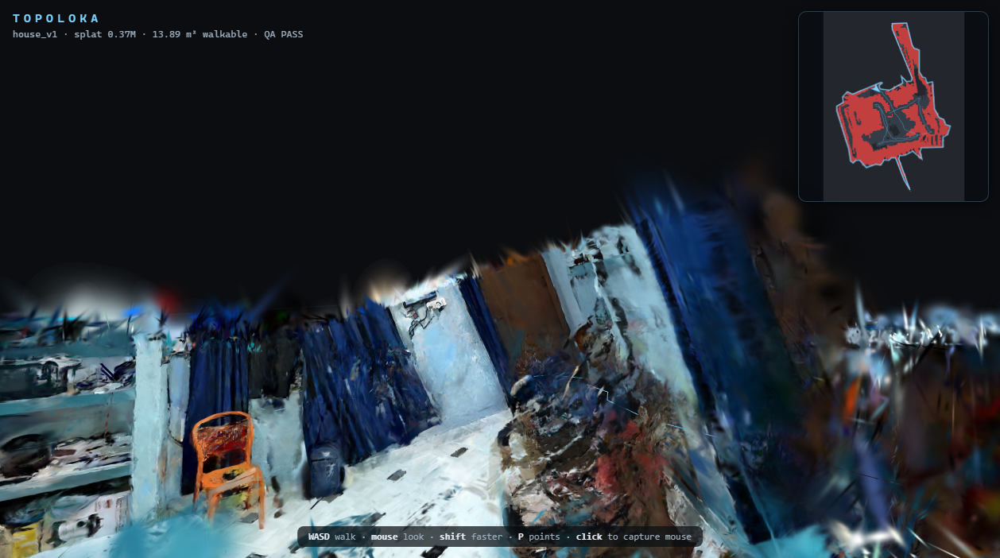

# Topoloka spatial twin engine

**One video in. Google Maps for indoors out — in a link.**

*Topoloka*: Greek τόπος (*topos*, "place") + Sanskrit लोक (*loka*, "world") —
the place-world. Turns a walk-through video of an indoor space into an
interactive, metric 3D digital twin served as a shareable web link: free
first-person roaming, spatial point-of-interest (POI) search, and
obstacle-aware walking directions in the browser. Built for Techfest 2026-27
(IIT Bombay).

```
walk-through video ──► Kaggle pipeline ──► artifact bundle ──► web app (static link)
 (phone SOP or         frames → SfM          splat + nav graph      search / jump / route
  licensed clip)       → depth → 3DGS       + POIs + QA           + sandbox / (R3) AR
```

## Repository layout

| Path          | What it is |
|---------------|------------|
| `capture/`    | Capture SOP + capture QA tooling (the "how to record" contract) |
| `pipeline/`   | Reconstruction pipeline (frames → SfM → geometry → depth → splat → POIs → export) |
| `web/`        | The viewer web app (roaming, minimap, navigation, splat renderer) |
| `kaggle/`     | Kaggle tooling: code dataset, kernels, push/fetch scripts |
| `docs/`       | Technical abstract, submission links, figures, demo build |
| `test/`       | Redistributable sample capture + reproduction instructions |
| `tools/`      | Sample builder and figure helpers |

## Compute rule

**All pipeline runs execute on Kaggle** (CPU or GPU), driven by `kaggle/`.
The local machine only edits code, commits, and talks to the Kaggle CLI.
See `kaggle/README.md`.

## Captured and benchmark samples

The repository packages sample builds with complete paper trails. The hosted
viewer publishes both the **Studio Room** (`room`) with 1.59M Gaussians and
live in-viewer orientation controls, and the **Melbourne Metro benchmark**
(`metro_v1`), switchable from the in-viewer dropdown:

| Sample | Source | Size | Measured |
|---|---|---|---|
| `web/public/artifacts/room/` | High-fidelity studio interior (30k 3DGS, floater-free) | 48.6 MB | 1,593,376 splats, 73.3 m² walkable, real-time in-viewer orientation controls |
| `test/metro_v1/` | *Modern Melbourne Metro Walkway Urban Design* by Joolsmagool (Pexels License), 86.07 s | 24.7 MB | 216/216 registered, 0.403 px median, 457,221 splats; 315.05 m² walkable |

The hosted viewer opens **Melbourne Metro — POIs & navigation** by default (the
R2 sample: 7 authored POIs, spatial search, and walkable routes) and allows
switching to **Studio Room** (a visual benchmark with interactive orientation
controls) via the **VIEW SAMPLE** picker.

**Hosted viewer:** <https://sciencebanda09.github.io/topoloka/>

It opens Melbourne Metro. **View model** switches between the Gaussian splat
and point cloud; A/D sidesteps around objects. Press `/` to search the POIs,
click a result to inspect it, and **Navigate** for a route. The Studio Room
costmap is synthetic all-free space, so it demonstrates rendering and
orientation, not pathfinding. R2 evidence and the demo script live in
[`docs/r2_evidence.md`](docs/r2_evidence.md); the POI contract is
[`docs/poi.md`](docs/poi.md).



*The shipped sample twin: 457,221 Gaussian splats, the metric minimap
(red = obstacles, blue = capture path), and the QA verdict in the HUD. The
viewer now renders with the capture's own lens (68.0° horizontal / 41.6°
vertical) instead of a generic wide FOV, and hides the point-cloud debug grid
once the splat loads. Reflective walls still render softer than the tiled
floor; the geometry and sightlines are metric.*

**Locally** (Node 20+):

```powershell
# stage every committed sample where the viewer fetches artifacts
foreach ($sampleDir in Get-ChildItem test -Directory) {
  $bundlePath = Join-Path $sampleDir.FullName 'web'
  if (Test-Path $bundlePath) {
    $artifactPath = Join-Path 'web\public\artifacts' $sampleDir.Name
    New-Item -ItemType Directory -Force $artifactPath | Out-Null
    Copy-Item -Recurse -Force (Join-Path $bundlePath '*') $artifactPath
  }
}
cd web
npm ci
npm run dev        # open http://127.0.0.1:5173/ (Metro sample by default)
```

```bash
# same, on a POSIX shell
for web_bundle in test/*/web; do
  sample_name="$(basename "$(dirname "$web_bundle")")"
  mkdir -p "web/public/artifacts/$sample_name"
  cp -r "$web_bundle"/. "web/public/artifacts/$sample_name"/
done
cd web && npm ci && npm run dev
```

Drag to look, **WASD/arrows** to walk, **M** toggles the minimap, **P** toggles
the point cloud behind the splat. The viewer opens at a clear captured camera
pose inside the reconstructed volume; append `?t=<index>` to spawn at a
specific trajectory point (`?t=0` is the true start), and
`?clean` to hide the click prompt and fps readout. Unobserved space is not
walkable: collision blocks it and carves a 1 m free corridor along the capture
path, which the camera proved traversable.

**R2 controls.** `/` (or `Ctrl/Cmd+K`) focuses search; typing never moves the
walker. Results cover names, aliases, categories, prefixes, substrings, and
small typos. Selecting a result, a 3D marker, or a minimap dot highlights the
POI but leaves the camera alone; **Jump here** flies to its authored view, and
**Navigate** plans a route. **E** opens the POI editor (click the floor, name
the place, save locally, export `pois.json`). `?q=<query>` opens search and
`?poi=<id>` deep-links to a POI view. The dev flag `?route` still draws the A*
route to the end of the capture (20.3 m / 350 waypoints from the default
spawn). On touch devices the left half is a walk stick and the right half
looks; **M** hides the map for a full-screen view. `npm run build` produces a
static `dist/` that can be served from any web host.

**R2 bonus — sandbox pick-and-place.** Press **G** in the viewer (or append
`?sandbox=1` to the same URL): keys **1–4** add a cone, barrier, crate, or wet-floor sign;
click to pick up/place; **R** rotates; **Del** removes; **T** toggles the route.
Placed props are real meshes layered over the read-only splat and become
dynamic costmap obstacles, so A* and collision reroute around them — including
an active POI route. They are not scanned furniture — see
[`docs/sandbox.md`](docs/sandbox.md) for the honest boundary, controls, and
implementation.

**Frame budget (measured, live Pages build).** On an AMD Radeon integrated GPU
through ANGLE/D3D11 at a 1600×900 viewport, the adaptive renderer holds
**51.0 fps idle / 60.1 fps walking** at the default spawn and **43.0 / 40.2
fps** at the worst corridor view `?t=90`; both runs kept the internal buffer
at 1155×650. In a 390×844 DPR2 mobile layout with touch emulation it holds
**59.9 / 60.2 fps** (desktop GPU, so this validates the layout and input path,
not phone thermals). The viewer renders with `antialias: false` — MSAA was
the dominant cost on this iGPU and the splat edges do not need it — and drops
the internal buffer in 0.08 steps only when the true frame rate falls below
32 fps (`?scale=` pins it for measurement). The HUD reports true frame time;
it previously clamped `dt` before computing FPS, which put a fake 20 fps floor
on every reading.

**Reproduce the pipeline:** the exact kernels that produced this capture are in
`kaggle/kernels/` and are driven by the scripts in `kaggle/tools/` — see
`kaggle/README.md` and `test/metro_v1/README.md`.

## Status

- [x] Repo skeleton, capture SOP, frame picking, QA gates
- [x] SfM (`pycolmap` 4.2.1) — 216/216 registered on the metro clip
- [x] Metric depth fusion (Depth Anything V2 Metric Indoor Large) + scale alignment
- [x] Geometry: floor plane, gravity align, 2.5D 5 cm costmap, outline
- [x] Splat training (nerfstudio 1.1.5 splatfacto, 25 k iters) + web `.splat` export
- [x] Web: first-person viewer, collision, minimap, splat renderer, `?t` spawn
- [x] Viewer fidelity/perf pass: capture-matched lens, adaptive resolution,
      true-FPS HUD, minimap legend, debug geometry hidden after splat load
- [x] End-to-end public run — CPU SfM 59.2 min; GPU 79.0 min total; 510,336
      gaussians exported; 315.05 m² walkable; QA 6/6 PASS
- [x] Hosted Metro sample at the single public link; Guildhall outputs remain
      in the repository but are excluded from the deployed viewer
- [x] Guildhall MVS photo mesh: `test/guildhall-mvs` (5.52M fused points,
      650k mesh faces, 89.54% textured-face coverage; capture navigation is
      retained because the dense cloud did not yield a floor fit)
- [x] R1 public stand-in twin: `test/guildhall-v1` (90.0 s CC BY-SA 4.0 crypt
      walk; 218/218 registered, 0.515 px median, 458.81 m², 632,993 gaussians,
      QA 6/6 PASS; retained as a repository sample)
- [x] Demo video (3:33, 1920×1080/30) — hosted twin walk-through, QA/metric
      cards, A* route, limitations and roadmap:
      <https://github.com/sciencebanda09/topoloka/releases/download/r1-demo/topoloka_demo.mp4>
- [x] R2 bonus: sandbox pick-and-place with dynamic obstacles + rerouting
      (`?sandbox=1`; see `docs/sandbox.md`)
- [x] R2: POI contract + authoring editor; 7 authored Metro POIs across 5
      categories; validated/staged by `namma pois` and `namma package`
- [x] R2: in-browser 1 m bucket + inverted token index with fuzzy search,
      ranked results, category facets, 3D/minimap selection, and Jump/Navigate
- [x] R2: A* POI navigation with clearance, smoothing, turn instructions,
      remaining distance/ETA, live reroute, arrival toast, and `?poi`/`?q` links
- [x] R2 verification: 50 web tests + 21 pipeline tests, typecheck/build pass,
      `poi_dataset` QA PASS; evidence in `docs/r2_evidence.md`
- [ ] AR mode (QR-anchored relocalization, R3)

## Credit and licences

- *Modern Melbourne Metro Walkway Urban Design* by **Joolsmagool** on Pexels,
  used under the [Pexels License](https://www.pexels.com/license/) and trimmed
  to 86 s. The derived artifacts in `test/metro_v1` are redistributed under
  that licence.
- *Guildhall City of London England interior walkaround video* by **Acabashi**,
  Wikimedia Commons, used under
  [CC BY-SA 4.0](https://creativecommons.org/licenses/by-sa/4.0/) and trimmed
  to 305–395 s. The derived artifacts in `test/guildhall-v1` are distributed
  under CC BY-SA 4.0; see `test/guildhall-v1/LICENSE`.
- The same Guildhall source is used for `test/guildhall-v2`, with a stream-copied
  91.925 s segment beginning near 94 s. It is also distributed under CC BY-SA
  4.0; see `test/guildhall-v2/LICENSE`.
- The Guildhall MVS mesh uses that same licensed trim and is distributed under
  CC BY-SA 4.0; see `test/guildhall-mvs/LICENSE`.

The pipeline code is MIT. No personal capture is shipped.

## Deadlines

| Round | Due | Scope |
|-------|-----|-------|
| R1 | 31 Oct 2026 | SOP + 3D reconstruction + free-roam web viewer |
| R2 | 30 Nov 2026 | POIs + spatial search + desktop navigation |
| R3 | 16–17 Dec 2026 | On-site capture at IIT Bombay + live demo (+ AR bonus) |
