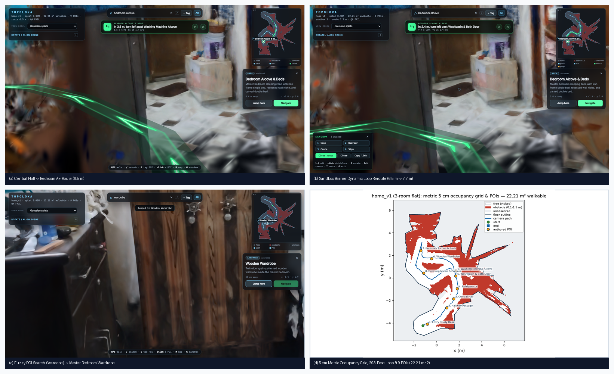

# Topoloka spatial twin engine

**One video in. Google Maps for indoors out — in a link.**

*Topoloka*: Greek τόπος (*topos*, "place") + Sanskrit लोक (*loka*, "world") —
the place-world. Turns a walk-through video of an indoor space into an
interactive, metric 3D digital twin served as a shareable web link: free
first-person roaming, spatial point-of-interest (POI) search, and
obstacle-aware walking directions in the browser. Built for **Namma Space — Techfest 2026–27 (IIT Bombay)**.

```
walk-through video ──► Kaggle GPU pipeline ──► artifact bundle ──► web app (static link)
 (phone SOP)           5 Hz frames → DISK+LG    .ksplat + nav       search / jump / route
                       → Apache-2.0 depth       + 9 POIs + QA       + sandbox / AR (R3)
                       → 3DGS + floater cull
```

## Hosted viewer & self-captured 3-room twin (`home_v1`)

**Hosted viewer:** <https://sciencebanda09.github.io/topoloka/>

All third-party and public datasets (`room`, `playroom`, `guildhall-*`, `metro_v1`)
have been permanently removed to comply with Round 2 Rule 1 (*Use your own data*).
The deployed twin (`test/home_v1/`, `19.42 MB` total committed) was reconstructed
end-to-end strictly from the team's own handheld 3-room flat walkthrough (**Entry
Study Room**, **Central Hall**, and a full closed loop through the **Master
Bedroom**):

| Measured Metric (`test/home_v1/`) | Result |
|---|---|
| **SfM Ablation (SIFT → DISK+LightGlue)** | SIFT 3 Hz `35/225` (`15.6%`, 10 models) → **Apache-2.0 Kornia `DISK+LightGlue` 5 Hz `296/375` (`78.9%`, `51,304` 3D pts, unbroken 293-frame 3-room loop)** |
| **Metric Depth (Apache 2.0)** | `Depth-Anything-V2-Metric-Indoor-Small-hf` · `293/293` fused (`732,355` edge-filtered voxels) · `scale = 0.65426 m/unit` (`MAD = 15.21%`) |
| **Metric Navigation (`5 cm` grid)** | `21.71 m²` walkable (`207 × 229`, `59,195` floor inliers, `camera_height = 0.857 m`, `0` geometry warnings, zero doorway radar-spikes) |
| **Compressed 3DGS & Live FPS** | **`13.95 MB`** Level-1 `.ksplat` (`580,000` Gaussians; `splatfacto-big` 30k + `SO3xR3` + `max_gauss_ratio = 3.5` reducing `p99.9` spike ratio `9,647:1 → 3.78:1`) · **`33.6–51.5 FPS`** @ `1440×810` (`1.5×` HiDPI) Chrome D3D11 (`0` errors) |
| **POIs, Fuzzy Search & A\* Routing** | **9 validated POIs** across 3 rooms (`0` warnings) · `"wardobe"` → `Wooden Wardrobe` (#1 hit) · **Entry Study Desk → Bedroom Alcove: `9.6 m`** (*"In 4.6 m, turn left past Refrigerator"*) |
| **Dynamic Sandbox Loop Reroute** | Placing 3 barriers across Wooden Wardrobe corridor dynamically reroutes **Central Hall → Bedroom Alcove** from **`6.5 m` → `7.7 m`** (and Bedroom Entry → Alcove **`2.4 m` → `5.4 m`**) around the Dressing Mirror leg |



## Repository layout

| Path | What it is |
|---|---|
| `capture/` | Deterministic Capture SOP (`capture/SOP.md`) + live capture runbook (`capture/phone-to-twin.md`) |
| `pipeline/` | Reconstruction pipeline (`frames` → `sfm` [SIFT / `disk_lightglue`] → `depth` → `geometry` → `metricize` → `splat-convert` → `pois` → `anchors` → `qa` → `package`) |
| `web/` | Static TypeScript + Three.js WebGL viewer (roaming, captured-VFOV clamp, 2D minimap, POI index, A\* navigation, sandbox, AR preview) |
| `kaggle/` | Kaggle CLI tooling: GPU `DISK+LightGlue` SfM (`kaggle/kernels/namma_sfm_gpu/`), T4 Depth+3DGS (`kaggle/kernels/namma_splat/`), and automation scripts |
| `docs/` | 4-page Technical Abstract & SOP (`docs/abstract.pdf`), R2 evidence (`docs/r2_evidence.md`), human narration script (`docs/demo/NARRATION_SCRIPT.md`), and loudness-normalized MP4 muxer |
| `submission/` | Ready-to-upload Round 2 Google Drive submission bundle |
| `test/home_v1/` | Team's committed self-captured 3-room twin bundle (`19.42 MB`, 9 POIs, complete honest QA trail) |
| `tools/` | Sample bundler (`make_sample.py`), capture activator (`activate_capture.py`), PDF & figure builders (`build_pdf.py`, `make_figures.py`) |

## Compute rule

**All heavy reconstruction stages execute on Kaggle GPUs** (GPU `DISK+LightGlue` SfM + T4 GPU Apache-2.0 metric depth & 3DGS), driven via `kaggle/`. Local hardware only edits code, runs unit tests, builds static web assets, and runs the Kaggle CLI. See [`kaggle/README.md`](kaggle/README.md).

## Local development (Node 20+ & Python 3.10+)

```powershell
# Stage the committed home_v1 twin where the viewer fetches artifacts
python tools\activate_capture.py home_v1 --label "Home 3-Room Twin — POIs & nav"
cd web
npm ci
npm run dev        # open http://127.0.0.1:5173/
```

```bash
# Same, on POSIX shells
mkdir -p web/public/artifacts/home_v1
cp -r test/home_v1/web/. web/public/artifacts/home_v1/
cd web && npm ci && npm run dev
```

### Controls & features

- **Free-roam & visualization:** Drag to look, **WASD / arrows** to walk (wall-colliding on the 5 cm metric costmap), **M** toggles the live 2D minimap, **P** toggles the colored metric point cloud behind the splat. Clamps vertical FOV to the captured smartphone lens shell (`23.9°`), streams an instant `cloud.ply` preview before swapping into `.ksplat`, and supports `?t=<index>`, `?orient`, and `?clean`.
- **R2 POIs, spatial search & A\* navigation:** Press **`/`** (or `Ctrl/Cmd+K`) to search names, aliases, categories, prefixes, substrings, and typos (1 m spatial bucket + inverted token + Levenshtein `≤ 2` index). Selecting a result, 3D marker, or minimap dot opens the card without moving the camera; **Jump here** flies to its authored pose (with proximity marker decluttering) and **Navigate** draws an obstacle-aware VCCW/EDT A\* floor route with landmark-anchored turn-by-turn guidance, ETA, off-route rerouting, and arrival detection. Press **`E`** to click-tag new POIs (`localStorage` + `pois.json` export). Supports `?q=<query>` and `?poi=<id>` deep links.
- **R2 Sandbox (`G` / `?sandbox=1`):** Keys **1–4** add cones, barriers, crates, or signs that dynamically carve obstacles into the live A\* router (see [`docs/sandbox.md`](docs/sandbox.md)).
- **R3 Bonus — AR Wayfinding (`AR` button):** Relocalizes onto printed QR fiducials (`anchors.json`, `namma anchors`) and overlays directional turn guidance over the live camera feed.

## Original work vs. third-party commercial dependencies

**Original team contributions (MIT License):**
- Deterministic multi-room smartphone Capture SOP (`capture/SOP.md`) & automated 6-gate QA / IMU blur checks (`qa.py`, `imu.py`).
- Apache-2.0 `DISK + LightGlue` GPU SfM integration (`sfm.py`, `kaggle/kernels/namma_sfm_gpu/`).
- Pairwise median SfM-to-metric-depth scale fusion (`depth.py`, `metricize.py`).
- Bed-rejecting gravity-prior RANSAC floor aligner & continuous corridor-carved 5 cm 2.5D occupancy costmap with exported look directions (`geometry.py`).
- Fog-floater, elongated needle-splat & ceiling-spike pruner (`splat_convert.py`, `make_sample.py`) and QR fiducial pose solver (`anchors.py`).
- Complete zero-backend TypeScript/WebGL viewer (`web/src/`): captured-VFOV shell clamping, proximity marker decluttering, spatial/fuzzy POI index (`pois.ts`), VCCW/EDT A\* router & Pure-Pursuit tracker (`nav.ts`, `navigation.ts`), dynamic obstacle sandbox (`sandbox.ts`, `props.ts`), minimap (`minimap.ts`), and AR HUD (`ar.ts`).

**Commercial-use open-source dependencies:** Every model and library permits commercial use (`pycolmap 4.2.1` BSD-3-Clause, `Kornia DISK + LightGlue` Apache 2.0, `Depth-Anything-V2-Metric-Indoor-Small-hf` Apache 2.0, `nerfstudio`/`gsplat` Apache 2.0, `PyTorch` BSD-3-Clause, `transformers` Apache 2.0, `OpenCV`/`NumPy`/`SciPy` Apache 2.0 / BSD, `Three.js`/`@mkkellogg/gaussian-splats-3d` MIT, `FFmpeg` CLI). Full licensing matrix and **Third-Party API vs. Own GPU Cost Analysis** (`~$0.50–$0.56/scene` self-hosted vs. `$2.50–$5.50/scene` commercial APIs; ~200-scene workstation breakeven) live in [`docs/abstract.pdf`](docs/abstract.pdf).

## Verification & Round 2 status

- [x] Deterministic Capture SOP (`capture/SOP.md`), automated QA, and IMU/EIS validation (`imu.py`, `qa.py`)
- [x] Self-captured 3-room indoor twin (`test/home_v1/`) reconstructed end-to-end on Kaggle GPUs; all public/third-party datasets purged
- [x] Commercially licensed Apache-2.0 `DISK+LightGlue` SfM (`78.9%` vs. `15.6%` SIFT baseline) + Apache-2.0 `Depth-Anything-V2-Metric-Indoor-Small-hf` scale alignment
- [x] Bed-rejecting RANSAC floor alignment (`21.71 m²`, `0` warnings), 30k `splatfacto-big` (`SO3xR3` + `max_gauss_ratio = 3.5`) + cigar-spike/floater pruning + `13.95 MB` Level-1 `.ksplat` (`580,000` Gaussians)
- [x] R2 POIs & navigation: 9 validated POIs across 3 rooms, 1 m bucket + fuzzy search, Jump/Navigate, landmark-anchored A\* (`9.6 m` 3-room route), live Sandbox loop reroute (`6.5 m → 7.7 m`), POI tagging (`E`), and R3 AR preview (`ar.ts`)
- [x] Automated test suite & live E2E passing: **63/63 web tests** (`vitest`), strict TypeScript, Vite build, **30/30 pipeline tests** (`pytest`), and Chrome D3D11 Playwright E2E (`33.6–51.5 FPS` @ `1.5×` HiDPI, `0` errors)
- [x] 4-page Technical Abstract & SOP PDF compiled within 5-page limit ([`docs/abstract.pdf`](docs/abstract.pdf)) with visual showcase, commercial license matrix & API-vs-GPU cost analysis
- [x] AI-TTS narration scripts & synthetic audio completely removed
- [ ] **Upload raw capture video & record own-voice R2 narration** (`home_v1_raw_full.mp4` + record human voice using [`docs/demo/NARRATION_SCRIPT.md`](docs/demo/NARRATION_SCRIPT.md) → mux via [`docs/demo/mux_submission_video.py`](docs/demo/mux_submission_video.py) → verify links in Incognito)

## Deadlines

| Round | Due | Scope |
|---|---|---|
| R1 | 31 Oct 2026 | SOP + 3D reconstruction + free-roam web viewer |
| R2 | 30 Nov 2026 | Self-captured multi-room space + POIs + spatial search + desktop navigation + human-narrated video |
| R3 | 16–17 Dec 2026 | On-site capture at IIT Bombay + live demo (+ AR bonus) |
