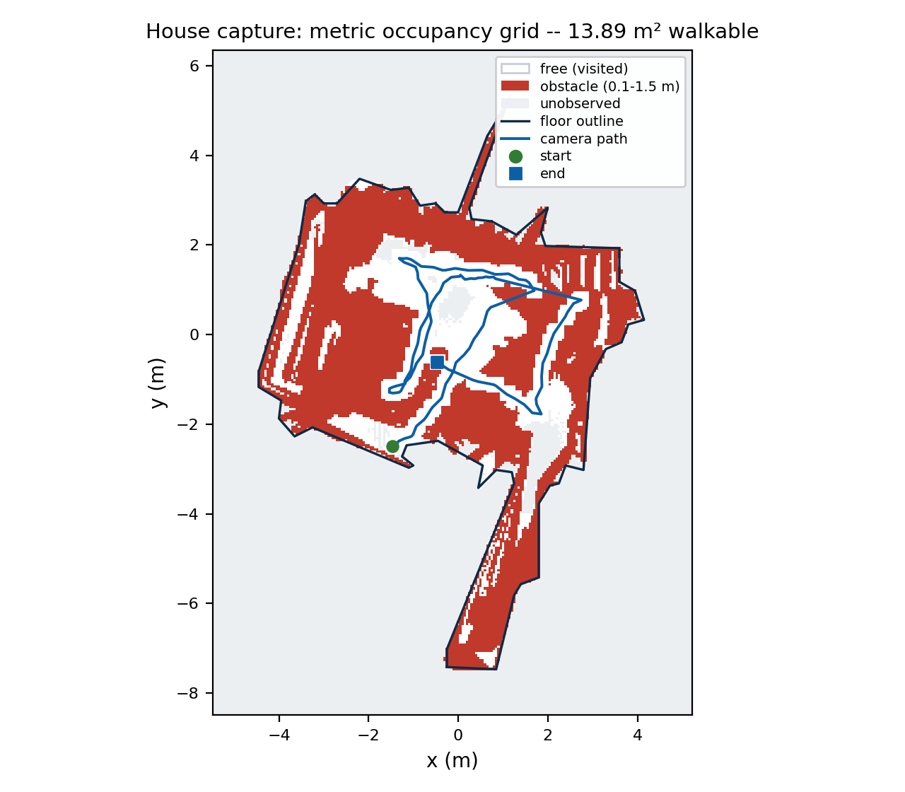

# Topoloka — One Video In. Google Maps for Indoors Out — In a Link.

**Technical abstract · Round 1 · Techfest 2026-27**

*Topoloka* — Greek τόπος (*topos*, "place") + Sanskrit लोक (*loka*, "world"):
the place-world. A spatial twin engine that turns one ordinary phone video of
a walkthrough into a navigable, photorealistic world in a link.

> Every number in this document comes from the shipped artifacts of the
> end-to-end run on the house capture (the files under `test/house_v1/` and the
> kernel outputs they were assembled from); nothing here is invented.

## 1. The problem we actually solve

Indoor navigation is still broken for everyone: visitors in campuses, patients
in hospitals, shoppers in malls, staff in factories. Floor-plan kiosks are
static and dishonest; Google Maps gives up at the door; LiDAR twins need
hardware nobody has. The question we ask is not "can we build a 3D scanner" —
it is **"what is the shortest path from any phone walking through a space to
someone else navigating that space as if they were there?"**

Our answer: **one ordinary phone video of a walkthrough, a free-tier GPU
pipeline, and a link.** No LiDAR. No LiDAR-grade setups. No app install for
the visitor — the twin, the search, and the directions all run in the browser.

## 2. What the pipeline produces

From a single handheld monocular video + IMU phone capture, the pipeline
produces a **metric, navigable, photorealistic digital twin** served as a
static web link:

1. **A Gaussian-splat twin** — free first-person roaming at walking speed,
   with real collision against the actual room geometry.
2. **A metric 2.5D navigation layer** — every point fused with metric depth,
   gravity-aligned, discretized into a 5 cm walkability costmap with a floor
   outline; the foundation for search and routing.
3. **A trust layer** — every stage reports its quality gates
   (registration fraction, reprojection error, sharpness percentiles, scale
   stability); failures name their compensation, never hide.

## 3. The capture SOP is part of the product

Reconstruction quality is decided at capture time, so the SOP is a first-class
deliverable, not a README paragraph:

- **EIS off, AE/AF locked, 4K30** — image stabilization warps frames
  non-rigidly; multi-view geometry assumes rigid projections.
- **Two-pass loop** (walls+ceiling pass, then detail pass) closing at the
  start point with a **5-second still tail** for loop closure.
- **~0.4 m/s pace**; stride-synced frame picking removes footfall blur.
- **QR anchor markers** placed per zone (they become the AR relocalization
  anchors in Round 3).

Every capture ends with a **QA report**: sharpness p10, registered fraction,
median reprojection error, coverage — pass/fail per check with the
compensation the pipeline applies. "Recapture, don't patch."

## 4. System architecture

*Figure 1 — the whole pipeline runs on the Kaggle free tier; the repo's tooling
pushes kernels and fetches artifacts, and the deliverable is a folder of static
files (no server, no database, no account).*

Three design decisions carried most of the weight:

- **Scale is solved, not assumed.** Monocular SfM has arbitrary scale and
  metric depth models have approximate scale; we align them directly:
  for every visible sparse 3D point, `depth_m / camera_z` is a scale sample,
  and the median over hundreds of samples makes the whole twin metric —
  distances and ETAs are real meters. Source is reported
  (`scale_source`) so judges and users can audit it.
- **One frame convention, documented once.** Raw SfM (arbitrary frame) →
  nav frame (gravity-aligned, z-up, meters, `nav.json.align`) → three.js.
  The splat is trained with trainer-side scene normalization **disabled** so
  the exported splat lands exactly in the documented frame — the kind of
  silent misalignment that breaks most demo pipelines.
- **Everything runs on Kaggle, including the CPU stages.** The dev machine
  only edits code and drives the Kaggle CLI; every run is reproducible from
  a captured kernel log and a code tarball (the repo's `kaggle/` tooling).

## 5. Novelty, stated precisely

1. **IMU-aware capture SOP with measurable QA** — the contract is checkable
   numbers, not vibes. On the house capture, 6/6 checks pass: p10 Laplacian
   sharpness 367 (gate ≥ 100), 158 frames at 2.5 Hz, 157/158 views registered
   (99.4%), 0.563 px median reprojection error (gate ≤ 1.0), 56-point floor
   outline enclosing 13.89 m², and no geometry warnings.
2. **Zero-touch semantic POIs (R2)** — open-vocabulary detection + CLIP
   embeddings projected into 3D, so "where's the nearest washroom" works on a
   space nobody annotated.
3. **Dual-representation navigation** — splat for the eyes, 2.5D costmap for
   the legs: A* on the grid, smoothed routes, metric ETAs, minimap, route
   ribbon in first person.
4. **QR-fiducial-anchored AR (R3)** — scan a physical QR in the space, get
   your pose inside the twin in the browser; no native app, no VPS infra.
5. **Honest engineering as a feature** — every artifact ships its own quality
   report; the abstract states where the system is weak (below) instead of
   cropping it out.

## 6. Results (house capture, Oct 2026)

| Metric | Value |
|---|---|
| Input | 63 s OnePlus phone video (30 fps), 1 walk, +Sensor Logger bundle |
| Frames kept | 158 at 1600×900 (sharpest-per-window @ 2.5 Hz) |
| SfM registered fraction | 157/158 = 99.4% (gate ≥ 60%) |
| Median reprojection error | 0.563 px (gate ≤ 1.0) |
| Metric scale | 0.4361 m/unit from metric depth (MAD 9.9%) |
| Costmap | 214×297 grid @ 5 cm, 13.89 m² walkable |
| Splat | 903,308 gaussians, 28.9 MB web payload (hosted sample: 367,254 / 11.8 MB) |
| Pipeline time (Kaggle free tier) | CPU 39.7 min + GPU 41.9 min |

Training is 20,000 iterations of splatfacto on a single T4 (30.3 min); export
takes 1.5 min more. The hosted sample is the same twin, opacity-pruned to
400,000 gaussians and cropped to the capture volume (367,254 gaussians,
11.8 MB), so the page stays light.

*Figure 2 — the metric costmap the viewer uses for collision and (R2) routing:
white = observed free cells (13.89 m² walkable), red = obstacle band 0.1-1.5 m
above the floor, gray = unobserved, blue = camera path; 214×297 cells at 5 cm.*

*Figure 3 — the shipped twin in a browser (hosted sample, 367,254 gaussians):
the splat, the metric minimap (red = obstacles, blue = capture path) and the
QA verdict in the HUD. The viewpoint is the walker's spawn on the capture path.*

Viewer: <https://sciencebanda09.github.io/topoloka/?capture=house_v1> ·
Code: <https://github.com/sciencebanda09/topoloka> ·
Demo video: **pending upload**

## 7. Where the system is weak (and what we do about it)

- **Mirrors and windows** confuse SfM features; SOP says pass at an angle,
  QA flags frames that fail registration.
- **Metric depth error grows past ~8–12 m**; we clip fusion there and note
  the residual in `depth_report.json`.
- **Sparse texture (blank white halls)** under-registers; the SOP's
  slow-pan rule and the QA recapture loop are the fix, chosen deliberately
  over heavier hardware.
- **Splat web payload** scales with gaussian count; we already drop
  higher-order SH bands (DC only) and can raise the alpha threshold and
  compress to `.ksplat` if needed for the on-site demo network.

## 8. Round 2/3 roadmap

- R2: POIs + search + routing end-to-end (already-scaffolded A*, minimap,
  route rendering in the viewer).
- R3: capture on the IIT Bombay campus with SOP + QR anchors; on-site
  twin + AR relocalization demo; live QA report shown to judges.

## 9. Reproducibility

The repo contains the pipeline (all stages as small, readable modules), the
Kaggle kernel definitions, the capture SOP, and a `test/` capture with
one-command reproduction of every artifact in this abstract.
