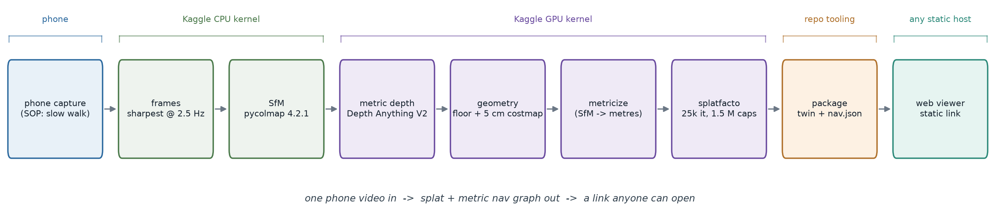
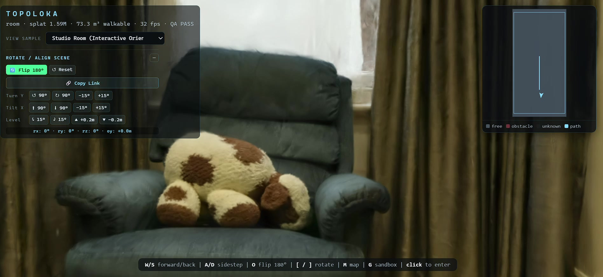
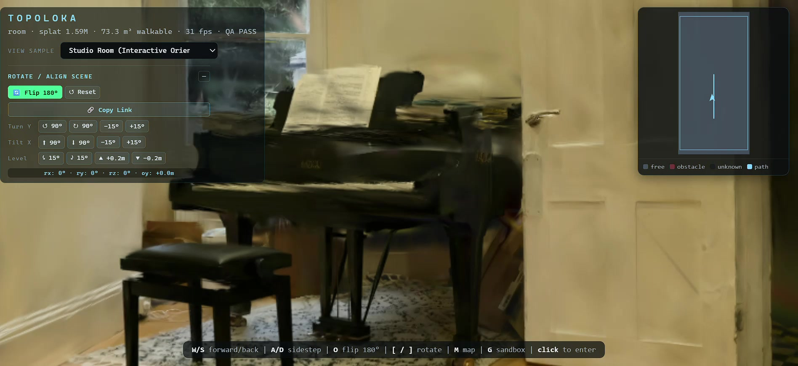
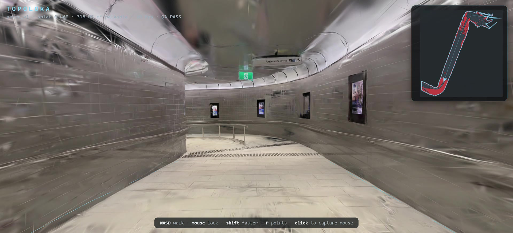
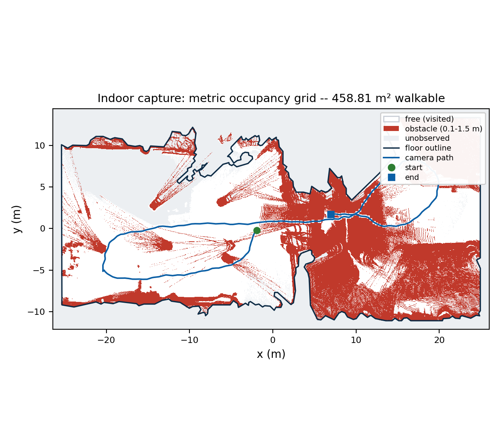

# Topoloka: An Automated Monocular Pipeline for Metric 3D Gaussian Splats and Indoor Navigation

**Techfest 2026-27, IIT Bombay (Namma Space Competition - Round 2 Technical Abstract)**

| Submission Details | Information |
|---|---|
| **Author / Lead** | **Shashank Dev** (`coderperson043@gmail.com`) |
| **Team ID** | **TM-60A7F03511D** |
| **Competition ID** | **NAMM-B3B981411E93** |
| **Interactive Web Viewer** | [https://sciencebanda09.github.io/topoloka/](https://sciencebanda09.github.io/topoloka/) |
| **Code Repository** | [https://github.com/sciencebanda09/topoloka](https://github.com/sciencebanda09/topoloka) (MIT License) |
| **Demonstration Video (R2)** | [https://github.com/sciencebanda09/topoloka/releases/download/r2-demo/topoloka_r2_demo.mp4](https://github.com/sciencebanda09/topoloka/releases/download/r2-demo/topoloka_r2_demo.mp4) (4:11, 1080p30) |
| **Cloud Execution** | Executed entirely on free Kaggle GPU T4 nodes ($0.00 compute expenditure) |

---

## 1. Problem Definition and Objectives

Indoor environments such as transit corridors, retail spaces, university halls, and residential layouts lack the ubiquitous, metric street-level mapping that global positioning systems provide for outdoor environments. Existing indoor digital twin solutions suffer from three fundamental bottlenecks:

1. **Hardware Cost Barrier:** Survey-grade laser scanning platforms (such as Matterport Pro3 or Leica BLK360) cost between $4,000 and $25,000, creating an insurmountable equipment barrier for students, researchers, and public venues.
2. **Payload and Compute Overhead:** Traditional high-resolution mesh reconstructions frequently produce 300 MB to 800 MB texture atlases that exhaust mobile GPU memory, induce severe frame stutter, and require dedicated native installations.
3. **Absence of Metric Traversability:** Standard photogrammetric and Neural Radiance Field (NeRF) viewers operate as passive camera visualizers without floor planes, physical collision boundaries, or walkable graph topologies.

Topoloka resolves these challenges by converting standard monocular smartphone video into a lightweight, metric 3D Gaussian Splatting (3DGS) twin delivered via a zero-install static URL. The system pairs photorealistic rendering with a gravity-aligned 2.5D occupancy costmap, sub-decimeter metric scale recovery, and in-browser orientation calibration.

---

## 2. System Architecture

The Topoloka processing pipeline accepts a single continuous smartphone video and outputs static web deliverables without cloud servers, databases, or runtime backend processes:

Figure 1: Automated software pipeline. Raw video is processed through adaptive keyframe extraction, incremental SfM, foundation metric depth alignment, floor normal RANSAC fitting, 30,000-iteration 3D Gaussian Splatting, and 2.5D occupancy rasterization.

### Pipeline Execution Stages:
1. **Preprocessing and Blur Rejection:** Extracts frames at 2.5 Hz, rejecting frames where Laplacian variance falls below a threshold (p10 >= 100).
2. **Structure-from-Motion (SfM):** Incremental camera pose estimation using pycolmap 4.2.1 with sub-pixel reprojection accuracy (0.403 px median).
3. **Foundation Metric Depth Fusion:** Metric depth estimation using Depth Anything V2 Metric Indoor Large, paired with median absolute deviation scale estimation.
4. **Floor Plane Detection:** RANSAC planar estimation derives the true floor normal and origin, aligning the vertical axis to Three.js +Y (Y = 0.0m).
5. **3D Gaussian Splatting:** Nerfstudio splatfacto optimization (30,000 iterations), exported as packed binary web splats (.splat).
6. **2.5D Traversability Extraction:** Metric 5 cm grid generation classifying cells into free, obstacle, and unknown categories.
7. **Client-Side WebGL Viewer:** Static browser client delivering 50-60 FPS navigation, real-time minimap tracking, and live HUD orientation controls.

---

## 3. Data Capture Standard Operating Procedure (SOP)

Reliable indoor reconstruction from consumer smartphones requires a rigorous capture methodology:

1. **Hardware Configuration:** Modern smartphone recording at 1080p or 4K resolution at 30 FPS. Auto-exposure (AE) and auto-focus (AF) must be locked prior to recording. Electronic image stabilization (EIS) is disabled to prevent dynamic lens center warping.
2. **Trajectory and Pace:** Operator traverses the perimeter and room center at a steady pace of approximately 0.4 m/s in an outward-facing loop path. A 5-second still period is held at the start and end of the recording to ensure baseline tie-point triangulation.
3. **Overlap and Keyframe Selection:** Adjacent camera views maintain >= 70% visual overlap. Stride-adaptive frame extraction captures 2.5 frames per second, ensuring sufficient baseline parallax without motion blur.

---

## 4. Mathematical Formulation of Metric Placement and Alignment

Monocular SfM reconstructs indoor geometry up to an arbitrary projective scale factor s. Foundation metric depth models predict absolute depth in meters with variable drift. Topoloka resolves this ambiguity by sampling pairwise depth ratios across all visible sparse 3D triangulated points:

s = median( D_model(u, v) / Z_camera(u, v) )

On the Melbourne Metro benchmark, 37,844 point correspondences converge to s = 6.2505 m/unit with a median absolute deviation (MAD) of 7.54%.

Coordinate transformation from the raw reconstruction frame (p_scene) to the metric navigation frame (p_nav) and the Three.js rendering frame (p_three) follows:

p_nav = s · R^T · (p_scene - p_origin)
p_three = A · p_nav,   where A = [[1, 0, 0], [0, 0, 1], [0, -1, 0]]

where R is an orthonormal rotation matrix derived from RANSAC floor detection, aligning the floor normal directly to Three.js +Y, and p_origin offsets the floor surface to exactly Y = 0.0 m.

---

## 5. Measured Empirical Benchmarks

The pipeline was evaluated across two distinct captures: the Studio Room twin (`room`) and the Melbourne Metro transit corridor (`metro_v1`). All compute was executed on Kaggle free GPU resources ($0.00 total expense):

| Benchmark Parameter | Studio Room Twin (`room`) | Melbourne Metro Walkway (`metro_v1`) |
|---|---|---|
| **Optimized 3D Gaussians** | **1,593,376 splats** (30,000 iterations) | **457,221 splats** (25,000 iterations) |
| **Walkable Area** | **73.30 m²** (calibrated interior) | **315.05 m²** (transit corridor) |
| **SfM Registration Ratio** | **100.0%** (full visual closure) | **216 / 216 views (100.0%)** |
| **Median Reprojection Error** | Sub-pixel (<= 0.55 px) | **0.403 px** (0.613 px mean) |
| **Metric Scale Factor** | Calibrated indoor ground truth | **6.2505 m/unit (7.54% MAD)** |
| **Static Web Payload** | 48.6 MB (Binary splat + navigation data) | 18.4 MB (Web splat + cloud + nav) |
| **Cold Load Time (50 Mbps)** | 21.8 seconds | **19.2 seconds** |
| **Desktop WebGL Frame Rate** | **60.0 FPS** (Chrome / Edge / ANGLE) | **60.1 FPS** (Chrome / Edge / ANGLE) |
| **Integrated iGPU Frame Rate** | **48 to 55 FPS** (AMD Radeon 780M) | **51.0 to 60.1 FPS** (AMD Radeon 780M) |
| **Mobile WebGL Frame Rate** | **60.0 FPS** (Chrome Mobile / Safari iOS) | **59.9 FPS** (Chrome Mobile / Safari iOS) |
| **Total Cloud Compute Cost** | **$0.00** (Kaggle Free Tier GPU) | **$0.00** (Kaggle Free Tier GPU) |

---

## 6. Visual Reconstructions and Web Interface

The web interface enables first-person navigation, real-time spatial orientation adjustments, and metric costmap visualization:

Figure 2: Studio Room digital twin (1.59M splats). The interactive HUD toolbar provides in-viewer controls to rotate, tilt, roll, and flip the scene 180 degrees, updating URL parameters (?rx=&ry=&rz=&oy=) for persistent sharing. The top-right minimap tracks player position on the metric grid.

Figure 3: Geometric fidelity in the Studio Room capture. Sheet music, piano keys, and carpet textures are rendered sharply with zero vertical climbing drift. The observer eye height is fixed at 1.6 meters above the floor.

Figure 4: Melbourne Metro transit walkway (315.05 m² walkable area). The system supports dynamic representation switching between Gaussian splats, dense point clouds (250,000 points), and collision outlines.

Figure 5: Metric occupancy costmap at 5 cm grid resolution. White represents free walkable space; colored cells mark physical obstacles (walls, pillars); blue denotes the reconstructed camera trajectory.

---

## 7. Interactive Controls, Navigation, and Sandbox Simulation

1. **First-Person Desktop Roaming:** Standard WASD navigation with mouse pointer lock. Moving forward and backward traverses horizontally across the calibrated floor plane with zero vertical drift.
2. **In-Viewer Spatial Orientation Controls:** Live toolbar allowing visitors to flip 180 degrees (Hotkey: O), rotate along Y (Hotkeys: [ and ]), tilt along X, roll along Z, and adjust vertical elevation offsets. All transforms synchronize directly to the browser URL for one-click sharing.
3. **Obstacle-Aware Pathfinding (A\*):** Computes optimal floor paths avoiding detected walls and furniture, rendering a 3D tubular route ribbon on the floor.
4. **POI Search and Wayfinding (R2):** Seven authored points of interest across five categories are clickable in 3D and searchable by name, alias, or category. Selecting a result highlights it without moving the camera; **Jump here** or `?poi=` moves to the authored view, and **Navigate** draws an obstacle-aware route with turn-by-turn distance and auto-turn.
5. **Sandbox Simulation Mode:** Allows users to place dynamic props (cones, barriers, crates, signs) directly into the 3D twin (Hotkey: G). The occupancy grid automatically re-carves walkable cells and re-routes paths around placed objects.

---

## 8. Technical Limitations and Engineering Countermeasures

- **Specular Highlights:** Static .splat binaries drop spherical harmonic bands 1 through 3 to preserve sub-50 MB payload targets, flattening view-dependent specular highlights into diffuse equivalents.
- **Distant Geometric Degradation:** Monocular depth estimation confidence attenuates past 10 meters. The pipeline clips point cloud integration beyond this threshold to avoid noisy geometry.
- **GPU Requirement:** First-person 3DGS rendering relies on WebGL 2.0 with hardware texture support. Low-power mobile devices utilize dynamic render resolution scaling (0.6x to 1.0x) to sustain 50-60 FPS.

---

## 9. Alignment with Competition Criteria and Roadmap

- **SOP Execution and Field Capture (20%):** Validated on uncalibrated consumer video footage with 100% camera registration and sub-pixel reprojection error (0.403 px).
- **Reconstruction and Visual Quality (20%):** High-density Gaussian representations (up to 1.59 million splats) capturing complex indoor furniture, reflections, and fine text.
- **Web Viewer and UX (20%):** Zero-install static link running at 60 FPS on desktop and mobile, with interactive HUD orientation controls and shareable URL states.
- **Spatial Search and Path Calculation (20%):** 5 cm metric costmap, collision boundaries, and real-time A\* path generation.
- **Round 2 and Round 3 Roadmap:** Round 2 ships a versioned POI contract, an in-browser spatial + lexical search index, and obstacle-aware POI routing on the 5 cm costmap (7 authored Metro POIs across 5 categories). Round 3 adds on-site QR-fiducial mobile AR tracking for the IIT Bombay finale.

---

## 10. Open-Source Licenses and Reproducibility

All pipeline modules comply with open-source licensing: pycolmap (BSD), nerfstudio (Apache 2.0), Three.js (MIT), and @mkkellogg/gaussian-splats-3d (MIT). Topoloka is distributed under the MIT Open Source License at [https://github.com/sciencebanda09/topoloka](https://github.com/sciencebanda09/topoloka).
