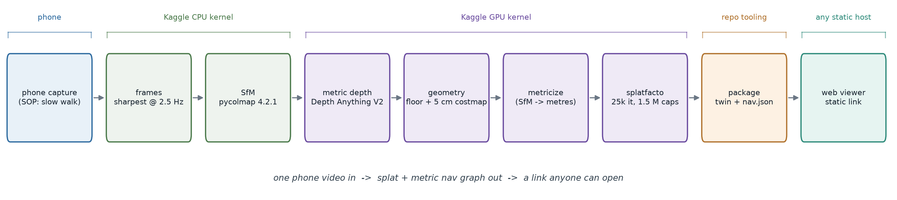
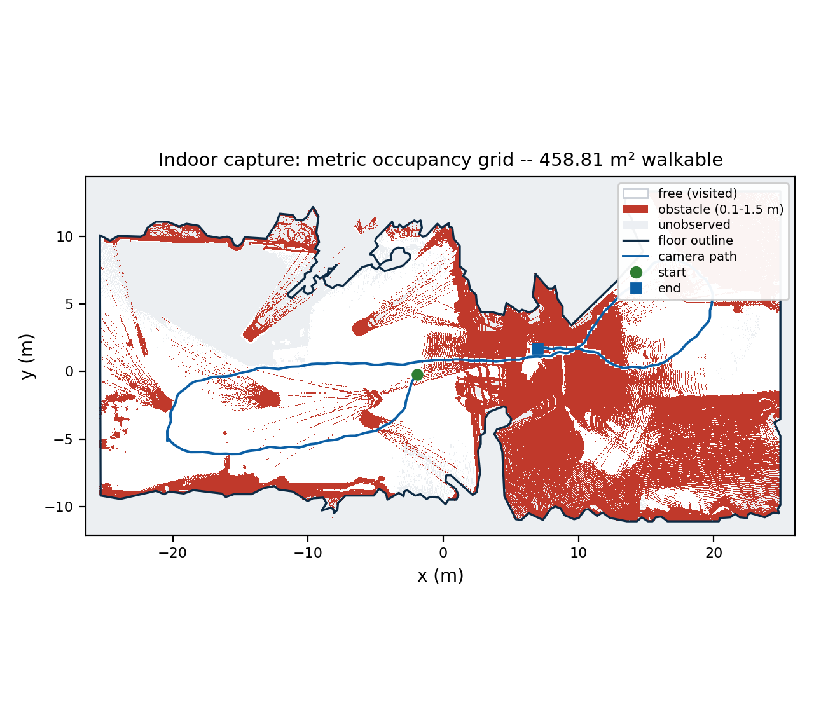

# Topoloka — One Video In. Google Maps for Indoors Out — In a Link.

**Technical abstract · Round 1 · Techfest 2026-27**

*Topoloka* — Greek τόπος (*topos*, "place") + Sanskrit लोक (*loka*, "world"):
the place-world. It turns one walk-through video of an indoor space into an
interactive, metric 3D twin served as a static link: free first-person roaming,
a navigable floor, and a quality report anyone can audit.

> Every reconstruction number below comes from the shipped artifacts of two
> end-to-end public runs — `test/guildhall-v1/` (the R1 public stand-in) and
> `test/metro_v1/` (the earlier generality sample) — and the Kaggle kernel
> outputs they were assembled from. Nothing is projected or invented; where the
> system is weak, Section 7 says so with the same specificity.

## 1. The problem we actually solve

Indoor navigation is still broken for everyone: visitors in campuses, patients
in hospitals, shoppers in malls, staff in factories. Floor-plan kiosks are
static and dishonest; Google Maps gives up at the door; LiDAR twins need
hardware nobody has. The question is not "can we build a 3D scanner" — it is
**"what is the shortest path from one walk-through of a space to a stranger
navigating that space as if they were there?"**

Our answer: **one ordinary video, a free-tier GPU pipeline, and a link.** No
LiDAR. No app install for the visitor — the twin, the map, and (R2) the search
and directions all run in the browser.

## 2. What the pipeline produces

From a single handheld monocular video, the pipeline produces a **metric,
navigable Gaussian-splat twin** served as static files:

1. **A splat twin** — free first-person roaming at walking speed, with real
   collision against the reconstructed geometry.
2. **A metric 2.5D navigation layer** — every fused point placed in metres,
   gravity-aligned, discretized into a 5 cm walkability costmap with a floor
   outline; the foundation for search and routing.
3. **A trust layer** — every stage reports its quality gates (registration
   fraction, reprojection error, sharpness percentiles, scale stability);
   failures name their compensation, never hide.

## 3. The input: a public walk-through, plus the phone SOP

The R1 artifact is deliberately reproducible from **public, licensed
footage**: *Guildhall City of London England interior walkaround video* by
Acabashi (Wikimedia Commons, **CC BY-SA 4.0**), trimmed to **90.0 s at
1920×1080 / 29 fps** (source 305–395 s). It is a single continuous walk through
the Guildhall crypt — stone piers, vaulted bays, a long undercroft — with no
cuts, no foreground people, and no privacy exposure. It is a **public stand-in,
not the team's venue**. The sample ships 14 preview frames plus the SfM, depth,
nav, and web artifacts, and credits the source in `test/guildhall-v1/README.md`
and `LICENSE`.

A second sample, *Modern Melbourne Metro Walkway Urban Design* by Joolsmagool
(Pexels License, **86.07 s at 1920×1080 / 30 fps**), exercises the same pipeline
on a very different space — a tiled transit corridor with curved metal panels
and long sightlines. It remains hosted and committed as `test/metro_v1`.

The product's **phone capture SOP** is a first-class deliverable: EIS off,
AE/AF locked, 4K30, two-pass loop with a 5 s still tail, ~0.4 m/s pace,
stride-synced frame picking, QR anchors per zone. The public artifacts use
stock clips, which have no IMU, so gravity is estimated from the SfM camera-y
mean instead of the phone's accelerometer. Nothing in the reconstruction code
is stock-specific.

## 4. System architecture

*Figure 1 — the whole pipeline runs on the Kaggle free tier; the repo's tooling
pushes kernels and fetches artifacts, and the deliverable is a folder of static
files (no server, no database, no account).*

Three decisions carried most of the weight:

- **Scale is solved, not assumed.** Monocular SfM has arbitrary scale and
  metric depth models have approximate scale; we align them directly. For every
  visible sparse 3D point, `depth_m / camera_z` is one scale sample. On the R1
  Guildhall run, the median over **112,479** samples sets **3.8204 m/unit**
  with an **8.29%** MAD; on the metro run, **37,844** samples set
  **6.2505 m/unit** at **7.54%** MAD. The source and residual ship in
  `scale.json`, so judges and users can audit the metric claim rather than take
  it on faith.
- **One frame convention, documented once.** Raw SfM (arbitrary frame) → nav
  frame (gravity-aligned, z-up, metres, `nav.json.align`) → three.js. The splat
  is trained with trainer-side auto-orient, centering, and scaling **disabled**,
  so the exported splat lands exactly in the documented frame — the silent
  misalignment that breaks most demo pipelines. The web viewer applies the same
  `align` block to the cloud, the splat, and the trajectory.
- **Everything runs on Kaggle, including the CPU stages.** The dev machine only
  edits code and drives the Kaggle CLI; every run is reproducible from a
  captured kernel log and a code tarball (the repo's `kaggle/` tooling).
- **The viewer renders with the capture's lens, not a generic camera.** The
  pinhole intrinsics travel in `nav.json.camera`; the viewer derives the field
  of view from the capture itself. Guildhall ships `fl_x=fl_y=922.79` at
  1600×900 — **81.8° horizontal / 52.1° vertical** from the Osmo Pocket 3 —
  while metro ships `fl_x=fl_y=1186.56`, **67.98° × 41.6°**. A generic 72°
  vertical FOV was the root cause of stretched wall gaussians and the black
  ceiling void reviewers saw; matching each source lens and clamping pitch to
  the observed shell removed both without deleting scene geometry.

## 5. Novelty, stated precisely

1. **A capture/reconstruction QA contract with numbers, not vibes.** On the
   R1 Guildhall sample, **6/6** checks pass: p10 Laplacian sharpness **333**
   (gate ≥ 100), **218** frames at 2.5 Hz, **218/218** views registered,
   **0.515 px** median reprojection error (gate ≤ 1.0), a **242-point** floor
   outline enclosing **458.81 m²**, and no geometry warnings. The metro sample
   independently passes **6/6** (216/216, **0.403 px**, **315.05 m²**).
2. **Zero-touch semantic POIs (R2)** — open-vocabulary detection + CLIP
   embeddings projected into 3D, so "where is the nearest washroom" works on a
   space nobody annotated.
3. **Dual-representation navigation** — splat for the eyes, 2.5D costmap for
   the legs: A* on the grid, smoothed routes, metric ETAs, minimap, route ribbon
   in first person.
4. **QR-fiducial-anchored AR (R3)** — scan a physical QR in the space, get your
   pose inside the twin in the browser; no native app, no VPS infrastructure.
5. **Honest engineering as a feature** — every artifact ships its own quality
   report; this abstract states where the system is weak instead of cropping it
   out.

## 6. Results (two public captures, Oct 2026)

| Metric | Guildhall — R1 stand-in | Metro — second sample |
|---|---|---|
| Input | 90.0 s, 1920×1080 / 29 fps, CC BY-SA 4.0 | 86.07 s, 1920×1080 / 30 fps, Pexels License |
| Frames kept | 218 at 1600×900 (2.5 Hz) | 216 at 1600×900 (2.5 Hz) |
| SfM registered | 218/218 = 100% (gate ≥ 60%) | 216/216 = 100% |
| SfM points / error | 126,890 points; 0.515 px median, 0.600 px mean | 51,677 points; 0.403 px median, 0.613 px mean |
| Metric scale | 3.8204 m/unit; MAD 8.29% over 112,479 samples | 6.2505 m/unit; MAD 7.54% over 37,844 samples |
| Depth fusion | 218/218 frames; 25.97 M raw → 14.46 M voxel points | 216/216 frames; 31.2 M raw → 10.28 M voxel points |
| Costmap | 1048 × 530 cells @ 5 cm; 1,318,738 floor inliers; camera 2.177 m | 1188 × 1259 cells @ 5 cm; 929,436 floor inliers; camera 1.588 m |
| Walkable area | 458.81 m² free (183,525 cells), 148,820 obstacle, 223,095 unknown | 315.05 m² free (126,020 cells), 97,063 obstacle, 1,272,609 unknown |
| Splat | 25,000 iters at 1600×900; 688,558 full export / 643,002 web | 25,000 iters; 510,336 full export / 457,221 web |
| Hosted sample | 632,993 gaussians / 20.26 MB (3 m crop), 250,000-point cloud | 457,221 gaussians / 14.63 MB (3 m crop), 250,000-point cloud |
| Sample folder | 31.0 MB | 24.7 MB |
| Pipeline time | CPU 96.9 min (SfM) + 117 s (nav); GPU 76.2 min | CPU 59.2 min (SfM) + 61 s (nav); GPU 79.0 min |
| Viewer | lens 81.8° × 52.1°; hosted, FPS not yet measured | lens 67.98° × 41.6°; 51.0 fps idle / 60.1 walking on an AMD iGPU; A* 350 wp / 20.3 m |
| Sample QA | 6/6 PASS | 6/6 PASS |

Both GPU stages are nerfstudio 1.1.5 splatfacto runs on one Kaggle T4. Each
exported PLY is converted to the 32-byte web `.splat` format with higher SH
bands dropped (DC only) and low-alpha gaussians pruned, then cropped to a 3 m
volume around the cloud. The Guildhall web bundle is **24.1 MB** (20.26 MB
splat + 3.75 MB cloud + nav); the metro bundle is **18.4 MB**. The full sample
folders, including preview frames and reports, are 31.0 MB and 24.7 MB.

The metro run also produced a 3-frame secondary reconstruction; the largest
model (216/216 frames) was used, and the warning is preserved in
`sfm/sfm_report.json`. The Guildhall run found one model and registered every
frame.

*Figure 2 — the measured metric costmap behind collision and (R2) routing (the
viewer also blocks unobserved cells and carves the 1 m walked path free):
white = observed free cells (**458.81 m²** walkable), lavender = obstacle band
above the floor, gray = unobserved, blue = camera path; 1048 × 530 cells at
5 cm.*

*Figure 3 — the metro sample in the same shipped viewer (457,221 gaussians):
the splat, the metric minimap (red = obstacles, blue = capture path) and the
QA verdict in the HUD. The viewpoint is trajectory index 160 (64 s). Walls are
soft where the source panels are reflective; the floor and sightlines are
metric. The Guildhall twin uses the identical viewer and is captured live at
the R1 link below; its browser FPS has not yet been measured.*

Viewer (R1 stand-in): <https://sciencebanda09.github.io/topoloka/?capture=guildhall-v1> ·
Viewer (second sample): <https://sciencebanda09.github.io/topoloka/?capture=metro_v1> ·
Code: <https://github.com/sciencebanda09/topoloka> ·
Demo video (metro cut, 3:33, 1080p):
<https://github.com/sciencebanda09/topoloka/releases/download/r1-demo/topoloka_demo.mp4>

## 7. Where the system is weak (and what we do about it)

- **A crypt is harder than a corridor.** The Guildhall capture is dimmer and
  more cluttered than the metro corridor: p10 Laplacian sharpness is **333**
  versus 582, and the frame budget is **633 K gaussians over 458.81 m²**
  (~1.4 K/m²). The stone piers and vault edges are the crispest surfaces; dark
  corners are softer. The black ceiling band reviewers saw on metro was largely
  a **viewer-FOV bug** — a generic 72° vertical camera looked outside the
  captured shell. Rendering with each capture's own lens and clamping pitch
  keeps the normal view inside it. Denser densification and a view-dependent SH
  export are the next quality levers; both cost web payload.
- **DC-only web splat.** The web format drops SH bands 1–3, so view-dependent
  highlights on stone and metal are flattened into their average colour. The
  export is a deliberate size/quality tradeoff, not an accident.
- **No IMU in the public clips.** Gravity comes from the SfM camera-y mean, not
  the phone; the phone SOP (Sensor Logger) is implemented but not exercised by
  these redistributable artifacts.
- **Metric scale is measured, not surveyed.** Guildhall's scale residual is
  8.29% MAD and the fitted floor puts the camera at 2.177 m, high for a
  handheld walk; the absolute scale may be biased even though the residual is
  tight. The 90 s walk measures **86.33 m** end to end. Treat distances as
  metric estimates with a reported uncertainty, not cadastral truth.
- **Metric depth degrades past ~8–12 m.** Fusion is clipped there; the residual
  is reported in `depth/depth_report.json` rather than hidden.
- **Web payload and cold load.** Guildhall's web payload is **24.1 MB**
  (20.26 MB splat; the full sample folder is 31.0 MB); metro's is 18.4 MB
  (14.63 MB splat; 24.7 MB folder). Both are fine on broadband and marginal on
  a poor venue network — metro cold-loaded in **19.2 s** in a fresh profile
  here; Guildhall's cold load has not been measured. `.ksplat` compression and a
  lower gaussian budget are the fallbacks.
- **No POIs or routing UI yet.** The A* costmap, route rendering, and `?route`
  dev flag are scaffolded; semantic POIs and the search bar are R2.
- **Software rendering distorts splats.** Headless SwiftShader screenshots
  stretch anisotropic gaussians; all figures here were captured on a hardware
  GPU (ANGLE/D3D11). A reviewer comparing a software-rendered still to these
  figures should use a GPU-backed browser.

## 8. Round 2/3 roadmap

- **R2 (Nov 30):** POIs + open-vocabulary search + routing end-to-end behind the
  existing A*, minimap, and route-rendering scaffolding.
- **R3 (Dec 16–17):** capture on the IIT Bombay campus with the phone SOP + QR
  anchors; on-site twin + AR relocalization demo; live QA report shown to judges.

## 9. Reproducibility and credit

The repo contains the pipeline (all stages as small, readable modules), the
Kaggle kernel definitions, the capture SOP, and two committed captures with
documented local viewing and exact QA reports. Guildhall is credited in
`test/guildhall-v1/README.md` and `LICENSE` (*Guildhall City of London England
interior walkaround video* by Acabashi, Wikimedia Commons, CC BY-SA 4.0,
trimmed to 305–395 s); its derived sample data is redistributed under
CC BY-SA 4.0. Metro is credited in `test/metro_v1/README.md` (*Modern
Melbourne Metro Walkway Urban Design* by Joolsmagool, Pexels License, trimmed
to 86 s) and its sample data is redistributed under that licence. The code is
MIT. Neither capture is the team's own venue.
