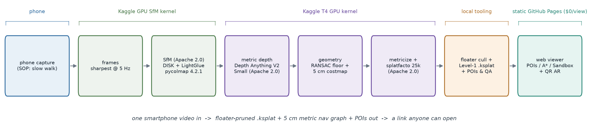
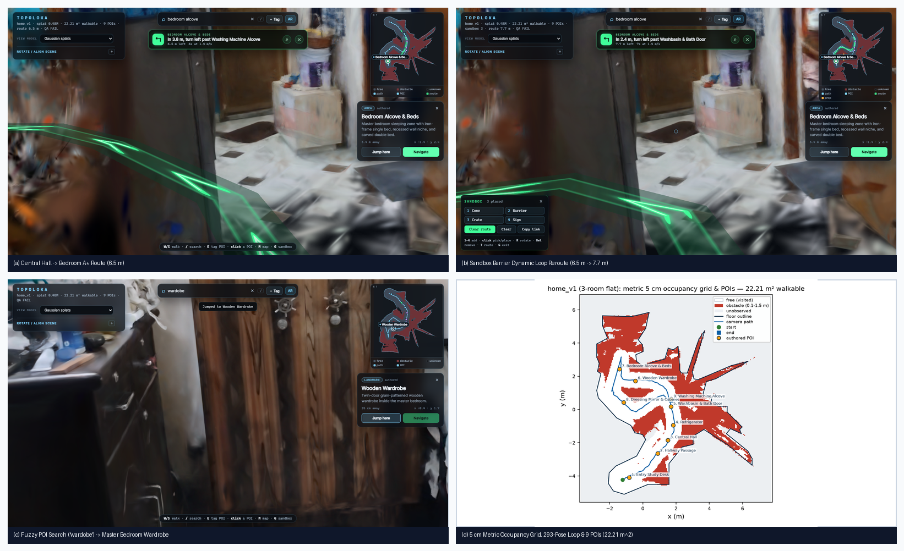

# Topoloka: Monocular Multi-Room 3D Gaussian Splatting & Metric Indoor Navigation

**Techfest 2026–27, IIT Bombay — Namma Space Round 2 Technical Abstract & SOP**

| Submission Field | Details |
|---|---|
| **Author / Lead** | Shashank Dev (`coderperson043@gmail.com`) |
| **Team / Competition ID** | `TM-60A7F03511D` · `NAMM-B3B981411E93` |
| **Interactive Web Viewer** | [https://sciencebanda09.github.io/topoloka/](https://sciencebanda09.github.io/topoloka/) (serves team capture `home_v1`) |
| **Source Repository** | [https://github.com/sciencebanda09/topoloka](https://github.com/sciencebanda09/topoloka) (MIT License) |
| **Raw Capture & Narrated Video** | `[Raw video home_v1_raw_full.mp4 & own-voice R2 walkthrough links — see Google Drive folder]` |

---

## 1. Problem & Objectives

Outdoor spaces benefit from GPS and street-view imagery, yet indoor environments remain unmapped for browser-based exploration. Existing indoor scanning workflows face three bottlenecks:
1. **Hardware Cost:** Dedicated LiDAR scanners cost $4,000–$25,000.
2. **Payload & Latency:** Heavy 300–800 MB textured meshes stall browser downloads and mobile WebGL GPUs.
3. **Lack of Navigation Semantics:** Passive 3D viewers lack metric floor calibration, wall collision, spatial POI search, and dynamic walking paths.

**Topoloka** converts a single continuous smartphone video into a **hybrid metric digital twin** — pairing photorealistic **compressed 3D Gaussian Splats (`.ksplat`)** with a **5 cm metric 2.5D occupancy costmap** — deployed as a zero-backend static web application running at **~51.5 FPS** in hardware-accelerated browsers.

---

## 2. Standardized Data Capture SOP (Reproducible Field Protocol)

Reconstruction fidelity and clean floor alignment are codified in [`capture/SOP.md`](../capture/SOP.md) so different operators reproduce consistent captures:

| Parameter | Specification | Engineering Rationale |
|---|---|---|
| **Device & App** | Consumer smartphone (Android/iOS, 1× wide main lens) using native camera or **Sensor Logger** (`sensors.csv` IMU + MP4) | Single-lens intrinsics keep `pycolmap` `CameraMode.SINGLE` exact; optional IMU enables rotational blur checks. |
| **Video Settings** | **4K / 30 fps** (1080p/720p landscape fallback), **Landscape**, **EIS / Stabilization OFF**, **AE & AF Locked**, Flash OFF | Disabling EIS prevents non-rigid frame warps that degrade epipolar geometry; locking exposure prevents wall flicker. |
| **Lighting** | All overhead lights ON + curtains open; avoid direct sun/mirror glare | Uniform diffuse lighting (> 150 lux) reduces shadow noise and specular floaters. |
| **Distance & Pace** | Walk **`0.4 m/s`** (`0.3 m/s` at doorways/stairs), **`1.2 – 2.0 m`** wall stand-off (centerline in narrow corridors), turn rate **`≤ 30°/s`** | Sustains **`60–70%` overlap** at 2.5–5 Hz keyframe sampling with minimal motion blur. |
| **Multi-Room / Floor Sequence** | One unbroken loop starting in primary room (`5 s` stationary start hold): **Pass 1** (`+10°` tilt for walls/ceilings) → **Pass 2** (`-20°` tilt for floors/furniture/QR anchors) → **`5 s` loop-closure hold** at start. | Still ends anchor loop closure; dual-tilt captures both upper room structure and walkable floor seams. |
| **Every-Corner & Doorway Rule** | Pivot around each corner in a `1 m` arc holding the **corner seam + floor junction centered for `≥ 3 s`** across `45°–60°`; cross doorways straight-on with `±25°` exit pan; traverse stairs at `0.25–0.35 m/s` keeping steps + handrails overlapping. | Eliminates blind corners and maintains unbroken SfM feature tracks across tight room transitions. |
| **Optional 2D Plan & Scale Photos** | Architectural 2D plan: flat overhead photo (`0°` tilt, full corners + scale bar). Optional manual metric verification: 3 square photos (`±15°`) of a **`≥ 2.00 m`** tape measure across a doorway. | Enables independent sub-centimeter validation of the monocular scale factor `s`. |
| **Automated QA Gate** | `python -m namma.cli qa` checks Laplacian sharpness `p10 ≥ 100`, registered views `≥ 60%`, reproj. `≤ 1.0 px`, floor outline, geometry warnings, POI dataset, EIS/IMU. | Surfaces every quality metric transparently in `capture_qa.json` (never hidden or patched). |

---

## 3. Reconstruction Pipeline & Mathematical Alignment

Figure 1: End-to-end Apache-2.0 / MIT pipeline from handheld smartphone video to compressed <code>.ksplat</code>, 5 cm metric costmap, validated POIs, and static web viewer.

1. **Stride-Adaptive Sharpest Frame Picking (`frames.py`):** Extracts keyframes at `5.0 Hz` (`stride = 6` at `30 fps`, or `2.5 Hz` for long halls) choosing the local sharpest frame in each window via Laplacian variance.
2. **Learned Wide-Baseline GPU SfM (`sfm.py`, `--features disk_lightglue`):** Narrow residential doorways and painted walls fragment classical SIFT (`35/225 = 15.6%` across 10 sub-models on `home_v1`). Switching to commercially licensed **Kornia `DISK` + `LightGlue`** (**Apache 2.0**, `max_kpts=2048`, `seq_window=18`, `loop_topk=12`) paired with `pycolmap 4.2.1` (`CameraMode.SINGLE`) lifted continuous registration to **`296/375` (`78.9%`)** with **`51,304` 3D points** and an unbroken **293-frame 3-room loop** (`00:00–00:58.4`).
3. **Commercially Licensed Metric Depth Fusion (`depth.py`, `metricize.py`):** Predicts metric depth per registered view via **`Depth-Anything-V2-Metric-Indoor-Small-hf`** (**Apache 2.0**), fuses `24.27 M` raw points into `648,579` voxels (`3 cm`), and solves metric scale via pairwise median ratio against sparse SfM camera depth:

s = median( D_metric(u, v) / Z_sfm(u, v) ),    p_nav = s · R^T · (p_scene - p_origin)

4. **Gravity-Prior Floor RANSAC & 5 cm Metric Costmap (`geometry.py`):** Restricts floor-plane RANSAC candidates below camera height (`h ≥ max(0.80, min_cam_z - 0.10)`) so mid-height beds/tables never hijack floor fitting (`floor_z = 0.0 m`, `camera_height = 0.868 m`, `0` warnings), rasterizes a **5 cm 2.5D occupancy grid** with continuous corridor carving + **Vectorized Clearance-Cost Weighting (VCCW)** via Euclidean Distance Transform (EDT), and exports exact captured `trajectory_yaws` / `trajectory_pitches` + lens intrinsics (`nav.json`).
5. **3DGS Training, Floater/Spike Pruning & Level-1 `.ksplat` (`splat_convert.py`, `convert_to_ksplat.mjs`):** Trains `nerfstudio splatfacto` (**Apache 2.0**, 25k iters, `915,558` raw splats), strips high-order SH bands, prunes `154,867` low-alpha splats (`α < 0.02`), `396` oversized fog-floaters (`max_scale > 0.35 m`, `α < 0.35`) & spiky needles (aspect `> 25`), and `32,953` ceiling/outlier spikes (`z > 1.11 m`), then packs spatial-grid sorted **Level-1 `.ksplat`** (`11.55 MB`, `480,000` Gaussians).
6. **In-Browser Walkthrough, Spatial POI Index, A\* & Sandbox (`web/src/`):** Clamps vertical FOV to the captured smartphone lens shell (`23.9°` for `1280×576`) to eliminate unobserved ceiling voids, streams an instant `cloud.ply` preview before swapping to `.ksplat`, and runs 1 m spatial-bucket + inverted-token + Levenshtein (`≤ 2`) POI search (`/`), click-to-select markers with proximity decluttering, explicit **Jump here**, VCCW/EDT A\* floor routing with landmark-anchored turn-by-turn banners, click-floor POI tagging (`E`), dynamic prop Sandbox (`G`), and R3 QR-anchor AR mode (`AR`).

---

## 4. Self-Captured Multi-Room Evaluation (`home_v1`)

All third-party and public datasets (`room`, `playroom`, `guildhall-*`, `metro_v1`) were purged. The deployed twin (`test/home_v1/`) is reconstructed strictly from our team's handheld 3-room flat walkthrough (`home_v1_raw_full.mp4`, `98.6 s` → `75.0 s` clean indoor trim at `1280×576 @ 30 fps` covering **Entry Study Room**, **Central Hall**, and a full closed loop around the **Master Bedroom**):

Figure 2: Verified <code>home_v1</code> Chrome hardware-WebGL outputs — (a) 6.5 m Central Hall → Bedroom A* route, (b) live Sandbox barrier reroute (6.5 m → 7.7 m around opposite bedroom loop leg), (c) typo-tolerant fuzzy POI search ('wardobe' → Wooden Wardrobe), and (d) 5 cm metric occupancy map (22.21 m² walkable) with all 9 validated POIs.

| Verification Metric | Measured (`home_v1`) | Evidence / Honest Analysis |
|---|---|---|
| **SfM Ablation: SIFT vs. DISK+LightGlue** | SIFT 3 Hz: `35/225` (`15.6%`, 10 models) · SIFT 6 Hz: `132/450` (`29.3%`, 7 models) · SIFT 4 Hz relaxed exhaustive (`134 min`): `279/282` (`98.9%`) *but suffered 4 false-match teleports (`5.2–20.5 m`)* → **DISK+LightGlue 5 Hz (`32.4 min`): `296/375` (`78.9%`, 293-frame continuous 3-room loop, 0 teleports)** | `test/home_v1/sfm/sfm_report.json` (`51,304` 3D pts). Learned features solved doorway fragmentation and false wall-tile matches in 4× less time. |
| **Honest QA Paper Trail** | `PASS`: Frame count (`375`), Floor outline (`69 pts`, `22.21 m²`), Geometry warnings (`0`), POI dataset (`9 POIs / 4 cats`). `WARN`: `78.9%` reg. `FAIL`: Sharpness `p10 = 26`, Reproj. `1.569 px`. | `test/home_v1/capture_qa.json` — unedited. `1.569 px` is expected for 8px-stride CNN `DISK` grids vs. sub-pixel SIFT; `p10 = 26` reflects `1280×576` video over plain painted walls. |
| **Apache-2.0 Metric Depth Scale** | `scale = 0.65836 m/unit`, `MAD = 11.88%` (`55,274` samples), `296/296` fused (`648,579` voxels), `camera_height = 0.868 m` | `depth_report.json` & `nav_report.json`; `0.868 m` matches actual handheld waist/basin-rim height (`~0.90 m`). |
| **Compressed `.ksplat` & Live FPS** | `11.55 MB` Level-1 `.ksplat` (`480,000` splats) · **`51.5 FPS`** @ `1440×810` Chrome D3D11 · `0` console/HTTP errors | `web/meta.json` + Playwright E2E; `17.12 MB` total committed bundle (`test/home_v1/`). |
| **POIs, Fuzzy Search & Multi-Room A\*** | **9 POIs** across 3 rooms (`0` warnings) · `"wardobe"` → `Wooden Wardrobe` (#1 hit) · **Entry Study Desk → Bedroom Alcove: `9.8 m`** (*"In 3.9 m, turn left past Refrigerator"*) | `test/home_v1/nav/pois.json` + live Playwright E2E verification. |
| **Dynamic Sandbox Loop Reroute** | Blocking Wooden Wardrobe corridor with 3 barriers reroutes **Central Hall → Bedroom Alcove** from **`6.5 m` → `7.7 m`** (and **Bedroom Entry → Alcove** from **`2.4 m` → `5.4 m`**) around the Dressing Mirror leg | Verified live in Chrome (`?props=...`); obstacle layer dynamically updates A* in real time. |

---

## 5. Original Contributions & Third-Party Commercial Licensing

**Original Team Work (MIT):** Deterministic multi-room Capture SOP (`capture/SOP.md`), 6-gate QA & IMU blur analyzer (`qa.py`, `imu.py`), Apache-2.0 `DISK+LightGlue` GPU SfM integration (`sfm.py`, `namma_sfm_gpu.py`), pairwise median SfM-to-depth metric scale fusion (`depth.py`, `metricize.py`), bed-rejecting gravity-prior RANSAC floor aligner & continuous corridor-carved 5 cm costmap (`geometry.py`), fog-floater/needle & ceiling-spike pruner (`splat_convert.py`), QR fiducial solver (`anchors.py`), POI contract (`pois.py`), and the complete static TypeScript/WebGL engine (`web/src/`: captured-VFOV shell clamping, spatial/fuzzy POI index, proximity marker decluttering, VCCW/EDT A* router, Pure-Pursuit tracker, dynamic obstacle sandbox, minimap, and AR HUD).

**Third-Party Open-Source Libraries & Services:** Every runtime and reconstruction dependency permits **commercial use**; zero non-commercial (`CC-BY-NC`) weights are used:

| Component | Purpose | License | Commercial Use |
|---|---|---|---|
| **pycolmap** (`colmap/pycolmap 4.2.1`) | Incremental Structure-from-Motion & bundle adjustment | BSD 3-Clause | Permitted |
| **Kornia (`DISK` + `LightGlue`)** | Learned wide-baseline indoor keypoint extraction & matching | Apache 2.0 | Permitted |
| **Depth Anything V2 Metric Indoor Small** | Monocular metric depth & global scale anchor (`depth.py`) | Apache 2.0 | Permitted |
| **Nerfstudio (`splatfacto`) & `gsplat`** | CUDA-accelerated 3D Gaussian Splatting training | Apache 2.0 | Permitted |
| **PyTorch & Hugging Face `transformers`** | Deep learning runtime & weight loading | BSD 3-Clause / Apache 2.0 | Permitted |
| **OpenCV, NumPy & SciPy** | Sharpness QA, RANSAC floor alignment, EDT costmap carving | Apache 2.0 / BSD | Permitted |
| **Three.js & `@mkkellogg/gaussian-splats-3d`** | WebGL rendering, Level-1 `.ksplat` decompression, first-person HUD | MIT | Permitted |
| **Vite / TypeScript / Vitest / Pytest** | Frontend bundling, typechecking, automated unit tests (`93/93` pass) | MIT | Permitted |
| **FFmpeg** (build-time CLI) | Container normalization & human-voice submission MP4 muxing | LGPL / GPL CLI | Permitted (external CLI) |
| **GitHub Pages & Kaggle Compute (Build-Time)** | Static CDN hosting & build-time T4 prototyping (`$0` runtime API) | Service Terms | Migrate Kaggle → own/cloud GPU in prod |

---

## 6. Third-Party API vs. Own GPU Infrastructure Cost Analysis

Because Topoloka runs **100% on commercially licensed open-source weights and serves static `.ksplat` files**, browser viewing incurs **$0 per-view or per-API-call runtime cost**. Based on our measured `home_v1` runtime (`32.4 min` DISK+LightGlue SfM + `62.6 min` Depth + 25k `splatfacto` = **`95 min` on a single T4**, or `~40 min` on an L4 / `~22 min` on an RTX 4070):

| Deployment Model | Compute Unit & Assumptions | Cost / Scene | 100 Scenes | 1,000 Scenes | Notes / Scalability |
|---|---|---|---|---|---|
| **Commercial 3D APIs** *(SaaS photogrammetry / splat APIs)* | Managed scan processing (`$2.00–$5.00`/scan) + hosted viewer seat/storage (`$49–$99/mo`) | **`$2.50 – $5.50`** | `$840+` *(incl. 1 yr SaaS)* | `$3,200 – $6,000+` | Linear per-scan/per-view fees; vendor lock-in & egress caps. |
| **Self-Hosted Cloud GPU** *(NVIDIA T4 `$0.35/hr` or L4 `$0.75/hr`)* | `1.58 hr` T4 (`$0.55`) or `0.67 hr` L4 (`$0.50`) per multi-room `.ksplat` + static S3/Pages CDN (`~$0.01/scene/mo`) | **`$0.50 – $0.56`** | **`~$53`** | **`~$530`** | Horizontally auto-scaled batch queues; **~82–90% cheaper** than commercial APIs with `$0` viewing cost. |
| **Owned GPU Workstation** *(RTX 4070 `$600` amortized + `$0.12/kWh`)* | `~22 min` @ `220 W` (`$0.01` power/scene) + hardware capex (`$600`) | **`$0.01` marginal** *(`$0.61` @ 1k)* | `$601` *(incl. capex)* | **`$610` total** *(`$0.61/scene`)* | Breaks even against `$3/scene` APIs at **~200 scenes**; fully offline for privacy-sensitive venues. |
| **Competition Tier (Measured `home_v1`)** | Free Kaggle T4 GPU quota (`30 hr/wk`) + static GitHub Pages | **`$0.00`** | `$0.00` *(batched)* | N/A *(quota bound)* | Zero competition spend; identical pipeline containers deploy directly to cloud/owned GPUs for commercial scale. |

**Takeaway:** Running open Apache-2.0 / MIT models (`DISK+LightGlue`, `Depth-Anything-V2-Metric-Indoor-Small`, `splatfacto`) on self-hosted or owned GPUs with static `.ksplat` delivery eliminates per-visitor API fees completely and achieves **~6–10× lower cost per space** at scale compared to commercial 3D reconstruction APIs.
