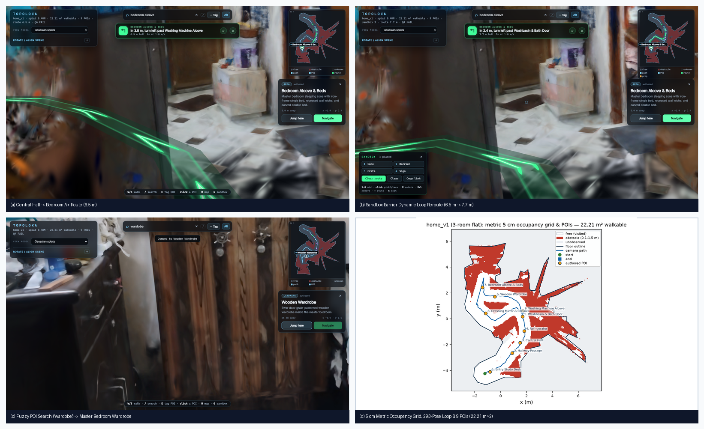

# R2 evidence: self-captured 3-room twin, POIs, spatial search & navigation

Round 2 (due **30 Nov 2026**) requires our own reconstructed multi-room indoor
space with browser walkthrough, 2D map, clickable POIs, spatial search, and
walkable obstacle-aware navigation. Every number below was measured directly on
our committed self-captured twin (`test/home_v1/`).

## Links

| Deliverable | Link |
|---|---|
| Live web app (`home_v1`) | <https://sciencebanda09.github.io/topoloka/> |
| Main repository (`main`) | <https://github.com/sciencebanda09/topoloka> |
| Synced R2 branch (`r2-pois-nav`) | <https://github.com/sciencebanda09/topoloka/tree/r2-pois-nav> |
| Technical Abstract & SOP (4-page PDF) | [`docs/abstract.pdf`](abstract.pdf) |
| POI contract & schema | [`docs/poi.md`](poi.md) |
| Self-captured twin artifacts | [`test/home_v1/`](../test/home_v1/) (`17.12 MB` total) |
| Raw capture video (`home_v1_raw_full.mp4`) | `[Upload kaggle/staging/raw_captures/home_v1_raw_full.mp4 to Drive & paste link]` |
| Own-voice R2 demo video | `[Record with docs/demo/NARRATION_SCRIPT.md & mux via docs/demo/mux_submission_video.py]` |

> **Rule 1 Dataset Compliance:** All pre-trained public 3DGS reconstructions
> (`room`, `playroom`) and third-party captures (`guildhall-*`, `metro_v1`) have
> been permanently removed from git and GitHub Pages. `test/home_v1/` is
> reconstructed exclusively from the team's own handheld 3-room flat video.

## Self-Captured 3-Room Reconstruction (`home_v1`)

- **Input:** Handheld smartphone walkthrough across **3 connected rooms** (Entry
  Study Room → Central Hall → closed loop around Master Bedroom → Central Hall;
  `98.6 s` raw `home_v1_raw_full.mp4` → `75.0 s` clean indoor trim at
  `1280×576 @ 30 fps`, `375` frames @ `5.0 Hz`).
- **SfM Ablation:** Classical sequential SIFT fragmented on narrow doorways (`35/225` =
  `15.6%` across 10 models @ 3 Hz; `132/450` = `29.3%` across 7 models @ 6 Hz),
  while relaxed exhaustive SIFT (`ratio=0.85, min_inliers=12`, `134 min`) registered
  `279/282` (`98.9%`) on paper but suffered **4 catastrophic false-match pose
  teleports (`5.2–20.5 m`, `Z = +7.5 m`)** on repetitive painted walls/tiles.
  Switching to commercially licensed **Kornia `DISK + LightGlue` (Apache 2.0)**
  + `pycolmap 4.2.1` (`32.4 min`, 4× faster) achieved **`296/375` (`78.9%`)**
  registered frames, `51,304` 3D points, and an unbroken **293-frame 3-room loop**
  (`00:00–00:58.4`) with **zero pose teleports**.
- **Metric Depth & Floor:** Apache-2.0 `Depth-Anything-V2-Metric-Indoor-Small-hf`
  fused `296/296` views (`24.27 M` raw → `648,579` dense voxels, `scale = 0.65836 m/unit`,
  `MAD = 11.88%` over `55,274` samples). Bed-rejecting gravity-prior RANSAC fit
  the true floor (`61,688` inliers, `camera_height = 0.868 m`, **`22.21 m²` walkable**,
  `232 × 250` @ `5 cm`, **`0` geometry warnings**).
- **3DGS & Pruning:** `nerfstudio splatfacto` (Apache 2.0, `25,000` iters,
  `915,558` raw splats) → pruned `154,867` low-alpha + `396` fog-floaters/needles
  + `32,953` ceiling spikes → packed **Level-1 `.ksplat` (`11.55 MB`, `480,000`
  Gaussians)**.
- **Honest QA Trail (`test/home_v1/capture_qa.md`):** `PASS` on frame count
  (`375`), floor outline (`69 pts`, `22.21 m²`), geometry warnings (`0`), and
  POI dataset (`9 POIs / 4 categories`); `WARN` on `78.9%` registration;
  unedited `FAIL` flags on `p10=26` Laplacian sharpness (soft painted walls at
  `1280×576`) and `1.569 px` median reprojection error (expected for 8px-stride
  CNN `DISK` keypoints vs. sub-pixel DoG SIFT).

## Authored POIs, Spatial/Fuzzy Search & Click Interaction (`home_v1`)

9 validated POIs across all 3 rooms and 4 categories (`area` 3, `facility` 3,
`landmark` 2, `exit` 1), all on verified free floor with exact captured camera
views (`0` validation warnings):

1. **Entry Study Desk** (`area`, Room 1)
2. **Hallway Passage** (`exit`, Room 1→2 transition)
3. **Central Hall** (`area`, Room 2 hub / default spawn)
4. **Refrigerator** (`facility`, Room 2)
5. **Washbasin & Bath Door** (`facility`, Room 2)
6. **Wooden Wardrobe** (`landmark`, Room 3 loop leg A)
7. **Bedroom Alcove & Beds** (`area`, Room 3 sleeping zone)
8. **Dressing Mirror & Cabinet** (`landmark`, Room 3 loop leg B)
9. **Washing Machine Alcove** (`facility`, Room 2 return loop)

- `web/src/pois.ts` builds a **1 m spatial bucket grid** + **inverted token
  index** + **Levenshtein (`≤ 2`) fuzzy matcher** at load time.
- Live verified fuzzy query: typing **`"wardobe"`** returns **`Wooden Wardrobe`**
  as the #1 hit (`3.8 m away`), opening its card without moving the camera;
  clicking **Jump here** flies smoothly to the authored Master Bedroom view
  (with proximity marker decluttering hiding the pin stem up close).

## Measured A\* Navigation & Dynamic Sandbox Loop Rerouting

`web/src/nav.ts` + `web/src/navigation.ts` + `web/src/sandbox.ts` (verified live
on `home_v1` in Chrome D3D11 Playwright E2E):

| Scenario | Route & Landmark Instruction | Distance & ETA |
|---|---|---|
| **3-Room Full Route:** Entry Study Desk → Bedroom Alcove & Beds | *"In 3.9 m, turn left past Refrigerator"* | **`9.8 m`** (`9 s @ 1.4 m/s`) |
| **Baseline:** Central Hall → Bedroom Alcove & Beds | *"In 3.8 m, turn left past Washing Machine Alcove"* (via Wooden Wardrobe leg) | **`6.5 m`** (`6 s @ 1.4 m/s`) |
| **Sandbox Reroute:** Central Hall → Bedroom Alcove (3 barriers blocking Wooden Wardrobe corridor) | *"In 2.4 m, turn left past Washbasin & Bath Door"* (loops around opposite Dressing Mirror leg!) | **`7.7 m`** (`+1.2 m` loop detour) |
| **Baseline:** Bedroom Entry → Bedroom Alcove | *"In 1.7 m, turn right past Wooden Wardrobe"* | **`2.4 m`** |
| **Sandbox Reroute:** Bedroom Entry → Bedroom Alcove (same 3 barriers) | *"In 1.8 m, turn right past Washbasin & Bath Door"* (full reverse loop around Master Bedroom!) | **`5.4 m`** (`+3.0 m` loop detour) |

## Automated Verification Suite

| Check | Command | Result |
|---|---|---|
| Pipeline unit tests | `python -m pytest pipeline/tests` | **30 / 30 pass** |
| Web unit tests | `cd web && npm test` | **63 / 63 pass** |
| TypeScript strict | `cd web && npm run typecheck` | **Pass** (`tsc --noEmit`) |
| Production build | `cd web && npm run build` | **Pass** (`web/dist/`) |
| POI validation (`home_v1`) | `python -m namma.cli pois test/home_v1` | **9 POIs across 4 categories, 0 warnings** |
| Chrome D3D11 WebGL E2E | Playwright (`1440×810`) on `home_v1` | **`51.5 FPS`**, **0 console errors**, **0 failed HTTP requests** |

## Honest Boundaries & Limitations

- **Single-floor 2.5D costmap:** `geometry.py` fits one dominant floor plane
  (`floor_z = 0.0 m`) and a single 2.5D grid; multi-room single-floor routing
  works out of the box, while multi-storey floor-transition routing is out of
  scope for the 2.5D planner.
- **POIs are authored, not auto-detected:** Click-floor tagging (`E`) +
  `namma pois` validation guarantees every label is human-verified on walkable
  floor.
- **DC-only `.ksplat`:** Higher spherical-harmonic bands are stripped for compact
  (`11.55 MB`) web streaming, so glossy/reflective surfaces remain softer than
  matte walls and wood.
- **Dynamic obstacles are local/URL-shared (`?props=`):** No backend database or
  multi-user sync; the entire viewer is zero-cost static hosting.
